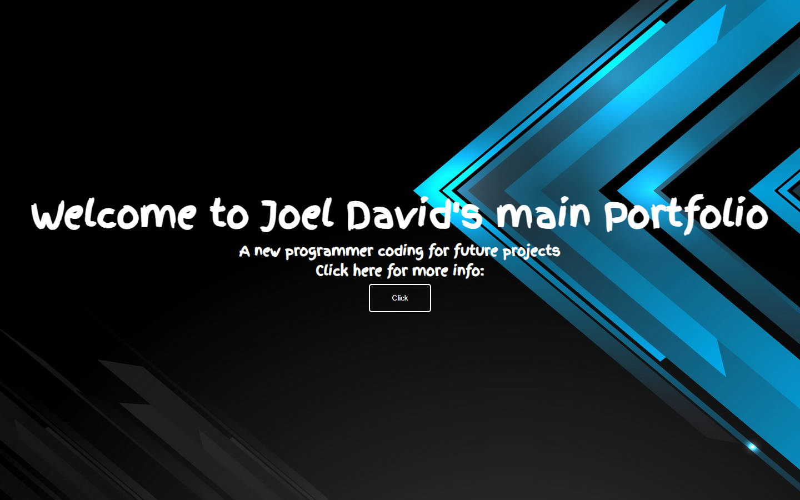

# Portafolio de Joel David

Mi portafolio reúne dos proyectos de desarrollo web hechos con HTML, CSS y JavaScript. Puedes explorar el sitio o abrir cada aplicación directamente en el navegador.

**[Visitar el portafolio](https://montillajoel.github.io/Joel-David-Portfolio/)**

## Proyectos

- **[Expense Tracker](https://montillajoel.github.io/Joel-David-Portfolio/all-my-proyects/Expense%20Tracker/index.html)** · Registro de gastos personales.
- **[To Do List](https://montillajoel.github.io/Joel-David-Portfolio/all-my-proyects/To%20Do%20List/index.html)** · Lista para organizar tareas pendientes.
